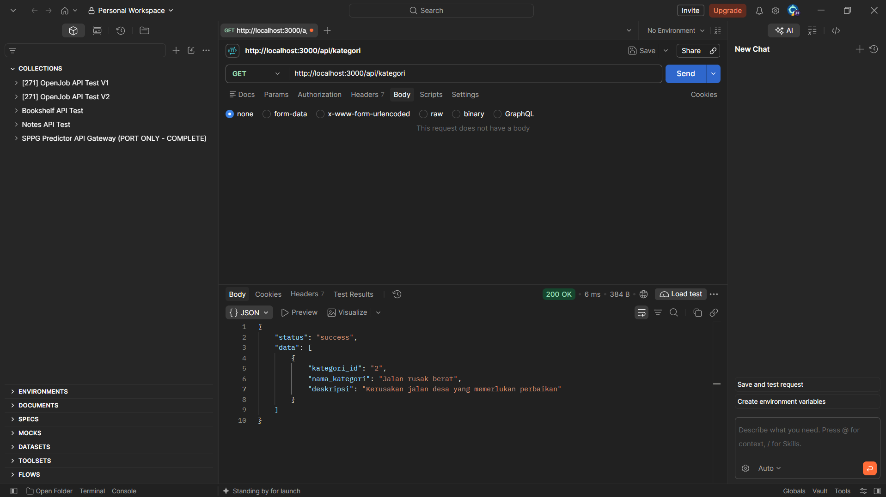
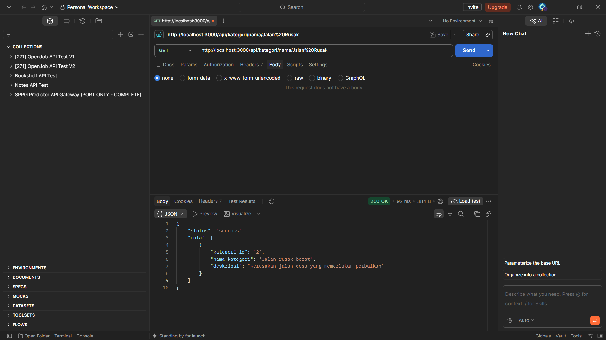
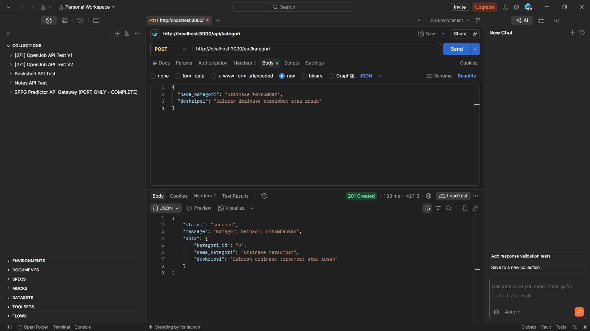
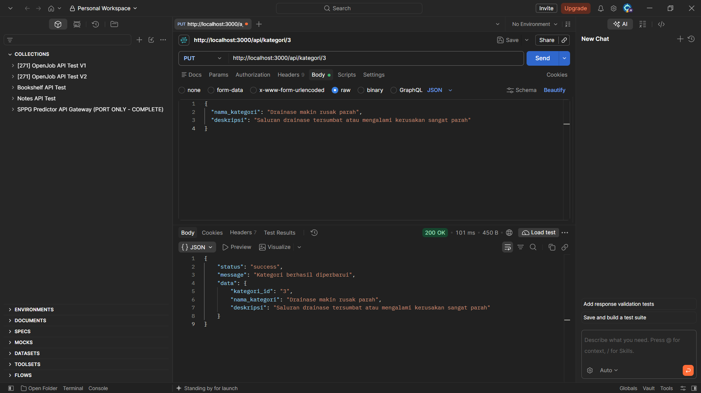
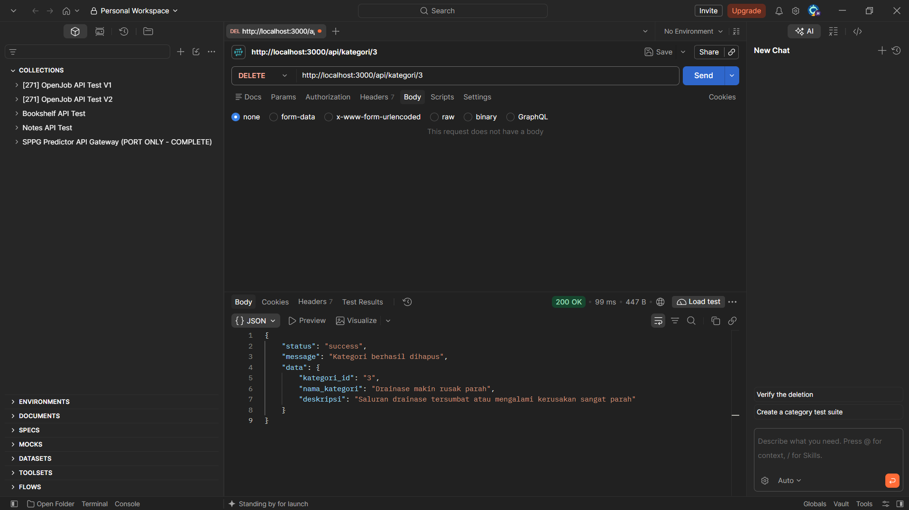

# Sistem Informasi Pelaporan Kerusakan Fasilitas Umum Desa

## Deskripsi Proyek

Proyek ini merupakan implementasi backend untuk **Sistem Informasi Pelaporan Kerusakan Fasilitas Umum Desa**. Sistem dirancang untuk mengelola data warga, kategori kerusakan, lokasi fasilitas, petugas, laporan kerusakan, verifikasi laporan, dan penugasan petugas.

REST API dibangun menggunakan Express.js dan PostgreSQL sebagai database.

## Teknologi yang Digunakan

- Node.js
- Express.js
- PostgreSQL
- `pg` untuk koneksi database
- `dotenv` untuk konfigurasi lingkungan
- Postman untuk pengujian REST API

## Struktur Proyek

```text
sistem-pelaporan-kerusakan-desa/
├── database/
│   └── schema.sql
├── src/
│   ├── controllers/
│   ├── db/
│   ├── routes/
│   └── server.js
├── screenshots/
├── .gitignore
├── package.json
├── package-lock.json
└── README.md
```

## Persiapan dan Instalasi

1. Pastikan Node.js dan PostgreSQL sudah terpasang.
2. Clone repository ini ke komputer:

   ```bash
   git clone https://github.com/HaikalErlana/Sistem-Pelaporan-Kerusakan-Desa.git
   ```

3. Masuk ke direktori proyek:

   ```bash
   cd Sistem-Pelaporan-Kerusakan-Desa
   ```

4. Instal dependensi:

   ```bash
   npm install
   ```

5. Buat database PostgreSQL dengan nama `pelaporan_kerusakan_desa`.
6. Jalankan file `database/schema.sql` pada database tersebut untuk membuat tabel dan relasi.
7. Buat file `.env` di direktori utama proyek dan isi sesuai konfigurasi PostgreSQL lokal:

   ```env
   DB_HOST=localhost
   DB_PORT=5432
   DB_NAME=pelaporan_kerusakan_desa
   DB_USER=nama_user_database
   DB_PASSWORD=password_database
   PORT=3000
   ```

   Sesuaikan `DB_USER` dan `DB_PASSWORD` dengan akun PostgreSQL yang digunakan. Jangan unggah file `.env` ke repository.

## Menjalankan Aplikasi

Jalankan server dalam mode pengembangan:

```bash
npm run dev
```

Atau jalankan dalam mode biasa:

```bash
npm start
```

Secara default, API berjalan pada:

`http://localhost:3000`

## Daftar Endpoint API

| Metode | Endpoint | Fungsi |
|---|---|---|
| GET | `/api/kategori` | Mengambil seluruh data kategori |
| GET | `/api/kategori/:id` | Mengambil kategori berdasarkan ID |
| GET | `/api/kategori/nama/:nama` | Mencari kategori berdasarkan nama |
| POST | `/api/kategori` | Menambahkan kategori baru |
| PUT | `/api/kategori/:id` | Memperbarui kategori |
| DELETE | `/api/kategori/:id` | Menghapus kategori |

Endpoint di atas merupakan contoh implementasi CRUD untuk tabel kategori kerusakan. Proyek ini juga menyediakan API untuk data laporan, lokasi, warga, petugas, verifikasi, dan penugasan.

## Hasil Pengujian API

Pengujian dilakukan menggunakan Postman terhadap enam operasi API kategori kerusakan.

### 1. GET — Seluruh Data



### 2. GET — Berdasarkan ID


### 3. GET — Berdasarkan Nama



### 4. POST — Menambahkan Data



### 5. PUT — Memperbarui Data



### 6. DELETE — Menghapus Data



## Database dan Diagram

Struktur database disimpan pada file `database/schema.sql`.

Diagram database dapat dilihat melalui tautan berikut:

[Diagram Sistem Informasi Pelaporan Kerusakan Fasilitas Umum Desa](https://dbdiagram.io/d/Sistem-Informasi-Pelaporan-Kerusakan-Fasilitas-Umum-Desa-6adafbe8f8963ca19c90b94c)

## Keamanan

File `.env` dan folder `node_modules/` dikecualikan dari repository melalui `.gitignore`. Konfigurasi database menggunakan variabel lingkungan agar kredensial tidak ditulis langsung dalam source code.

## Penutup

Proyek ini dibuat dalam berkelompok dengan implementasi REST API menggunakan Express.js dan PostgreSQL untuk mendukung pengelolaan data pada sistem pelaporan kerusakan fasilitas umum desa.